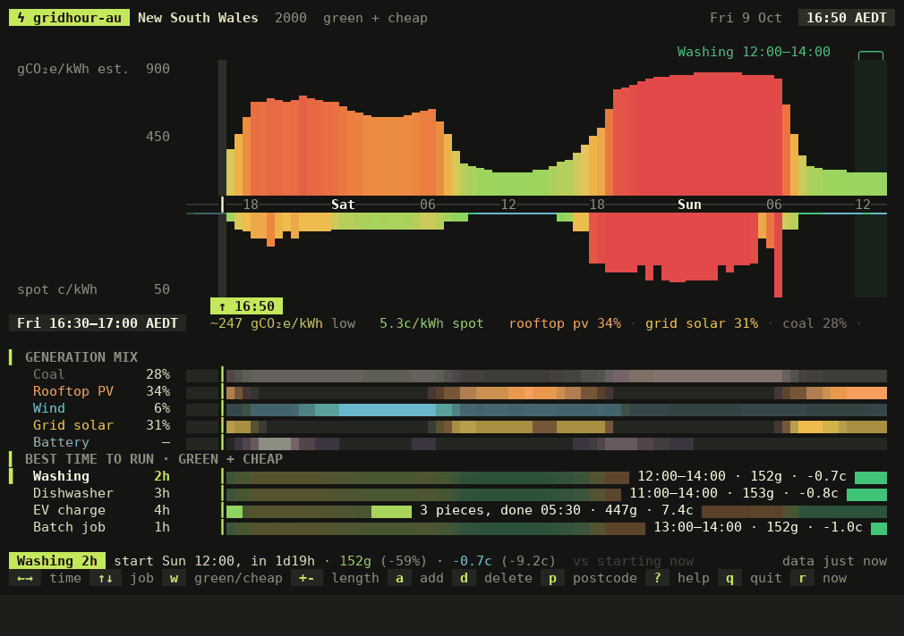
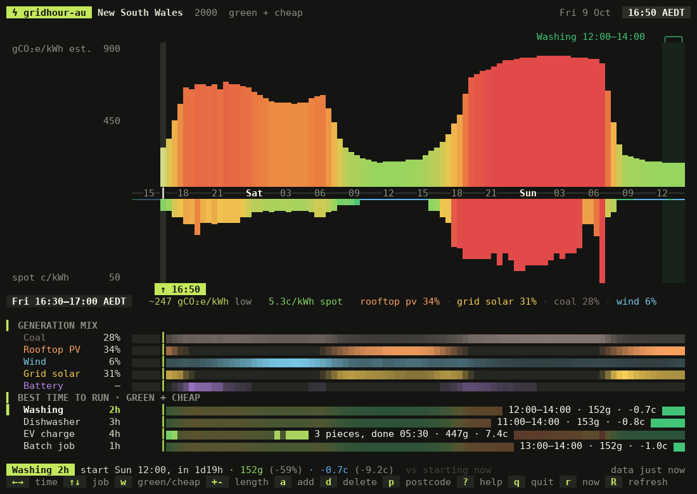
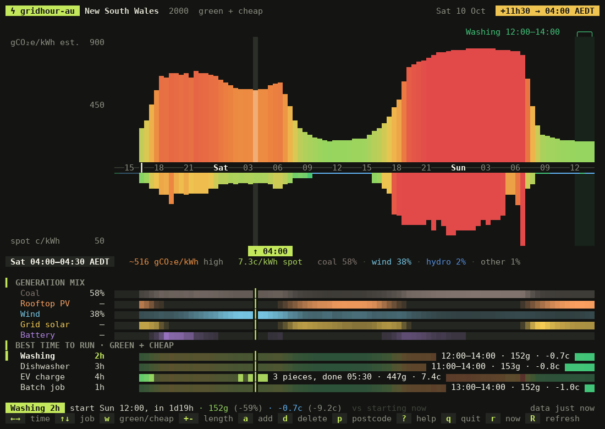
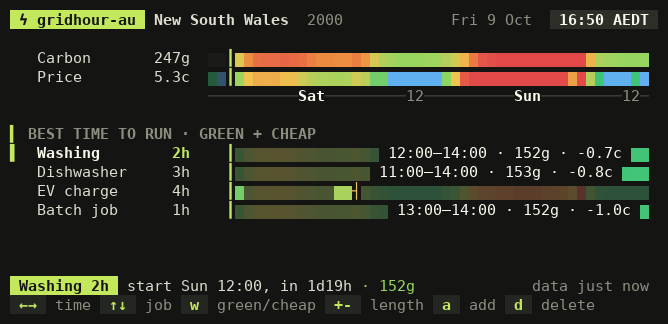

# gridhour-au

When is electricity in the Australian National Electricity Market (NEM) green and cheap?
gridhour-au shows the next 48 hours of estimated carbon intensity and wholesale spot prices for
your NEM region on one timeline in the terminal, then picks the best time to start the washing,
charge the car or kick off a batch job.

```console
$ gridhour-au --line
⚡ 247g · 5c · green now
```

It is an Australian port of [gridhour](https://github.com/777dimas/gridhour), which does the same
for Great Britain. The interface, jobs and outputs are the same; the data and the way carbon is
worked out are not (see [Where the numbers come from](#where-the-numbers-come-from)).



## What you see



- **The chart.** Estimated carbon intensity, in grams of CO₂ equivalent per kilowatt-hour
  (gCO₂e/kWh), rises above the time axis and the regional spot price hangs below it. Green is
  clean or cheap, red is dirty or dear, and blue is a negative price. Bars taller than 50 cents
  per kilowatt-hour (c/kWh) are cut so that one price spike doesn't flatten the rest. The hours
  already gone are dimmed.
- **Generation mix.** Coal, gas, hydro, wind, grid solar, rooftop solar and batteries as shares of
  your region's supply, on the same time axis.
- **Best time to run.** One row per job. Each row is shaded by how good every start time is, and
  the bright block is the best window, with its average carbon and price next to it. The status
  line tells you how much that saves against starting right now.
- **A cursor** runs straight down through all of it. Move it with the arrow keys to read any half
  hour; `Enter` jumps to the selected job's best window.

Times are shown in your region's local time, daylight saving included: Sydney is on Australian
Eastern Daylight Time (AEDT) in summer, while Brisbane stays on Australian Eastern Standard Time
(AEST) all year.

Jobs are ranked by carbon, by price, or by both (each normalised over the 48 hours and averaged).
`w` switches between them.

### Deadlines and jobs that can run in pieces

```
Washing      2h
EV charge    4h by 07:00 split
Battery      3h by 16:00 split
```

- **`by 07:00`** means the window has to finish by the next 07:00, local time. An amber `┤` marks
  the deadline on the job's row. If there isn't enough forecast before it, gridhour-au says so
  rather than suggesting a time after it.
- **`split`** lets it pick the best half hours before the deadline in any order. It only splits
  when the pieces really are better than one continuous block.

Type them in the add box (`a`), or select a job and press `b` for the deadline and `s` to allow
pieces.

| Scrubbed to tomorrow | Compact layout for a tmux split |
| -- | -- |
|  |  |

## Where the numbers come from

Everything comes from the public [NEMWeb](https://nemweb.com.au/Reports/CURRENT/) reports of the
Australian Energy Market Operator (AEMO). No account or key is needed.

| Report | Used for | Published |
| -- | -- | -- |
| `PredispatchIS_Reports` | price, demand, generation, grid wind and solar, per half hour | every 30 minutes |
| `Short_Term_PASA_Reports` | demand and forecast grid wind and solar after predispatch ends | hourly |
| `PD7Day` | price after predispatch ends | about 3 times a day |
| `ROOFTOP_PV/FORECAST` | rooftop solar | every 30 minutes |
| `Dispatch_SCADA` | what every unit is generating now | every 5 minutes |
| `CDEII/CO2EII_AVAILABLE_GENERATORS.CSV` | each unit's emissions factor and fuel | weekly |

Predispatch runs to 04:00 (NEM time) at the end of the next trading day, so it covers roughly the
next 16 to 40 hours depending on the time of day. AEMO's Short Term Projected Assessment of System
Adequacy (STPASA) and its seven-day predispatch (PD7Day) fill the rest of the 48 hours.

**Price** is the regional reference price (RRP) AEMO forecasts, divided by ten to give c/kWh. That
is the wholesale spot price, before network charges, the retailer's margin and the goods and
services tax (GST). If your retailer passes the wholesale price through to you, its rises and
falls are what you pay; on a flat or time-of-use tariff they aren't, and `--mode green` (or `w`)
ranks by carbon alone.

**Carbon** is an estimate. AEMO does not forecast emissions intensity, so for each half hour:

1. Grid wind and solar, and battery discharge, come from predispatch, as AEMO expects them to be
   dispatched. Rooftop solar comes from AEMO's rooftop forecast.
1. The rest of the region's generation (forecast generation, less grid wind, solar and batteries)
   is taken to come from the region's other units (coal, gas, hydro, diesel, bioenergy), in the
   proportions and at the emissions intensity they are running at right now. That intensity is
   each unit's latest 5-minute reading from AEMO's supervisory control and data acquisition
   (SCADA) system, multiplied by AEMO's emissions factor for that unit.
1. Battery discharge is counted at the intensity of the half hours the batteries charge in (see
   below).
1. Intensity = emissions of that fleet and the batteries / (fleet + batteries + grid wind + grid
   solar + rooftop solar).

### Past the end of predispatch

For the rest of the 48 hours (as much as 32 hours of it, in the early afternoon), AEMO publishes
no market forecast, only its STPASA reliability study. That has the region's demand and the wind
and solar output forecast to be available, but not how much the region will generate, so two
things are estimated:

- **Generation.** A region rarely generates exactly its demand: it exports when wind and solar run
  ahead of it and imports when they don't, and batteries and pumped hydro take some on top. Across
  the predispatch run, gridhour-au fits a straight line relating that gap (generation less demand)
  to how far wind and solar exceed demand, and uses it to turn STPASA's demand into generation.
  Wind and solar beyond what that generation leaves room for are taken as curtailed, and the fleet
  is never set below its lowest output in predispatch, because coal units keep running and export
  on a sunny afternoon.
- **Wind and solar.** These are the available-capacity forecast, the unconstrained intermittent
  generation forecast (UIGF). STPASA also has "cleared" figures, but they come from the
  reliability run, which dispatches only what it needs: across a week of New South Wales (NSW)
  noons they showed 1.6 to 2.0 gigawatts (GW) of solar against 2.8 to 5.0 GW forecast.

To test the line, it was fitted to the first half of a predispatch run and used to predict the
fleet's output in the second half. On both test days (9 and 27 October 2026), it cut the error in
NSW, Queensland and Victoria compared with taking generation as equal to demand: by 34% to 70%,
except in Victoria on 27 October, where the cut was 7%. In South Australia it was better on one
day and worse on the other. The fleet there is small (often under 200 megawatts, MW) and swings
with the interconnectors, so expect South Australia's later hours to jump about more. Where the
two reports meet, the NSW, Queensland and Victoria estimates matched to within 2% on both days.
Taking generation as equal to demand had produced steps of up to 5% on those days, and a review on
16 October found one of 11% in NSW.

These hours are still rougher than the predispatch ones. They assume the export pattern of the
next day and a half continues, and they know nothing about outages or interconnector limits.

The estimate leaves some things out, so treat the numbers as a guide to which hours are cleaner
rather than as exact figures:

- **Interconnectors.** The estimate is the intensity of what is generated in your region. Imports
  and exports are not followed, so Tasmania reads close to zero even when Basslink is bringing in
  Victorian coal power.
- **The fleet's mix changes.** Gas peakers that start for the evening peak, or coal units coming
  back from an outage, only show up once they are running.
- **Beyond predispatch.** Generation is estimated from demand, as described above.
- **Batteries.** They are shown as their own share of the mix (in Queensland at 19:00 NEM time on
  26 October 2026, they supplied 1.3 GW of 8.3 GW). A battery makes nothing: it returns energy the
  grid made earlier, so its output carries the carbon of when it was charged. That is the
  estimated intensity of the predispatch half hours in which the region's batteries charge,
  weighted by how much they take in. It covers the last 24 hours too: as each predispatch half
  hour passes, gridhour-au keeps the last forecast made for it, because batteries often discharge
  more than the current run shows them charging, drawing on what they held when the run began. In
  six runs on 26 and 27 October 2026, the charging intensity from the runs alone came to 2% to 44%
  of the fleet's intensity (lowest in South Australia, highest in Victoria). Adding the previous
  day raised it in 23 of the 24 combinations of region and run, and changed no half hour's
  estimate by more than 28 g. Two things are assumed:
  - Until gridhour-au has been running for a day, and for energy stored for longer than that,
    charging it cannot see is assumed to resemble the charging it can. Filling in that day from
    older predispatch runs on a fresh start doesn't help: across 6 runs and 4 regions on 26 and 27
    October 2026, using two or four older runs (6 to 24 hours back) left the result as far from
    the full-day figure as using the current run alone, typically 8 to 16 g in a half hour and at
    most 27 g. Forecasts made hours ahead expect batteries to charge in the clean middle of the
    day, as the current one does; only the final forecast for each half hour shows them also
    charging in dirtier hours, and collecting those would take one download per half hour.
  - Past the end of predispatch there is no battery forecast, so battery discharge there is
    counted as part of the fleet's share, at the fleet's intensity.
- **Small generators.** Small non-scheduled generators are not in the forecasts.
- **Units without an emissions factor.** A few running units are missing from AEMO's list (in
  October 2026, two Braemar gas units and two Kareeya hydro units in Queensland), so the fleet's
  intensity is worked out without them. In four snapshots, this made Queensland read 0.4% to 1.3%
  high.

"Green" means the estimate is under 250 gCO₂e/kWh (graded "very low" under 100, "low" under 250,
"moderate" under 450, "high" under 650 and "very high" above that). These are fixed bands, so in
Victoria and Queensland green hours are mostly sunny middays, while in South Australia and
Tasmania most hours qualify.

On the first run, the two hours before now are empty. After that, each half hour that passes keeps
the predispatch and rooftop forecasts made just before it. Its carbon is still worked out with the
fleet's current intensity, so it can shift a little from one refresh to the next. If a refresh
gets a new STPASA run but not the predispatch run that goes with it, the hours between the two
come from the previous STPASA run rather than being left empty.

Reports are reduced to a few numbers per half hour and cached in `~/.cache/gridhour-au`. A cached
report is checked for a newer one after 30 minutes (2 hours for the 5 MB PD7Day report, a day for
the emissions factors), and the file is only downloaded again if NEMWeb lists a newer one. If the
network is down, the app keeps showing the cached data and says how old it is.
`GRIDHOUR_AU_OFFLINE=1` stops all network access.

gridhour-au is not affiliated with AEMO.

## Install

You need Python 3.11 or newer, and a terminal with truecolor and a UTF-8 locale. It runs on Linux
and macOS; on Windows, use the Windows Subsystem for Linux (WSL). The simplest way to install it
is with [pipx](https://pipx.pypa.io/):

```sh
pipx install gridhour-au                                 # from the Python Package Index (PyPI)
pipx install git+https://github.com/vlasky/gridhour-au   # or straight from GitHub
gridhour-au 2000
```

From a clone, `pipx install .` does the same. To run it without installing anything, use
`python3 -m gridhour_au 2000`.

The postcode is remembered, so after the first run plain `gridhour-au` is enough. It is only used
to pick your NEM region and is never sent anywhere. Western Australia and the Northern Territory
are not part of the NEM, so their postcodes have no forecast.

`gridhour-au --reset` deletes the saved settings and the cache.

## Usage

```sh
gridhour-au                          # your saved postcode or region
gridhour-au 3000                     # a new postcode (saved)
gridhour-au --region sa              # a region instead: nsw (Australian Capital Territory too), vic, qld, sa, tas (saved)
gridhour-au --mode green             # rank by carbon only (also: cheap, both)
gridhour-au --no-prices              # carbon only, skips the 5 MB PD7Day download
gridhour-au --at 2026-10-10T00:00Z   # start with the cursor at a given time
gridhour-au --theme slate --12h
gridhour-au --reset                  # delete the saved postcode, jobs, settings and the cache
```

Keys inside the app (`?` lists them all):

| Key | Action |
| -- | -- |
| `←` `→` | move the cursor 30 minutes, Shift or `H` `L` for 2 hours |
| `Home` `End` `r` | start and end of the forecast, back to now |
| `↑` `↓` | select a job |
| `+` `-` | make the selected job 30 minutes longer or shorter |
| `a` `d` | add a job (`Dryer 1h30`, `EV 4h by 07:00 split`), delete the selected one |
| `b` `s` | selected job: finish by a time, allow it to run in pieces |
| `Enter` | jump to the selected job's best window |
| `w` | rank by carbon, price, or both |
| `p` | change postcode or region (`2000`, `vic`) |
| `m` `c` `T` `t` | mix rows, compact layout, theme, 12/24h |
| `R` | refetch now |
| `q` | quit |

Settings and jobs live in `~/.config/gridhour-au/config.json`.

## Status bars and scripts

```console
$ gridhour-au --line
⚡ 247g · 5c · green now

$ gridhour-au --line --best 3h
⚡ 247g · 5c · 3h best 11:00 (in 1d18h)

$ gridhour-au --tmux                 # same, with tmux colour codes for status-right
$ gridhour-au --watch                # same, updating in place
$ gridhour-au --json | jq '.jobs[] | {name, start: .best.from}'
$ gridhour-au --json --best 2h | jq '.best'
$ gridhour-au --ical > jobs.ics      # the best job windows as calendar events
```

If nothing in the next 48 hours is green, the line says `greenest in 9h` instead.

`--json` gives the current half hour, the next green slot, the best window for every job (its
deadline and pieces included, with the carbon and price you would get starting now) and the full
48-hour series. Prices are in c/kWh and times in Coordinated Universal Time (UTC). It has
`"schema": 1`; the [JSON reference](docs/json.md) lists every field, its unit and when it can be
`null`. Within schema 1, changes only add fields.

`gridhour-au --json --best 2h` adds a top-level `best` window for a two-hour job without touching
the saved jobs: its UTC `from` and `to`, `starts_in_minutes`, mean `carbon` and `price`, and the
`parts` it runs in. `best` is `null` if no complete window is available, and absent without
`--best`. The ranking mode applies, as for saved jobs.

`--json`, `--ical` and `--once` exit with status 2 when there is no forecast at all (offline with
an empty cache, or NEMWeb unreachable), so cron jobs and scripts can tell. They still print their
usual output, `errors` included. `--line` and `--tmux` exit 0 regardless, so a status bar goes on
showing the message.

For tmux, add `set -g status-right '#(gridhour-au --tmux) '` to `~/.tmux.conf`. For Waybar,
Polybar or i3blocks, run `gridhour-au --line` every 300 seconds; cached runs don't fetch on every
refresh.

## Security and privacy

gridhour-au makes HTTPS GET requests to `nemweb.com.au/Reports/` and nowhere else (redirects are
refused), sends nothing about you, and has no runtime dependencies. Downloads are capped at 8 MB,
and at 96 MB once unzipped. Every row is checked field by field before it is used or cached, and
text from outside never reaches your terminal or tmux with escape sequences or format codes in it.
Details: [SECURITY.md](SECURITY.md).

## Development

```sh
python3 -m venv .venv && . .venv/bin/activate
pip install --require-hashes -r requirements/dev.txt && pip install --no-deps -e .
pytest
```

The tests replay real NEMWeb reports from `tests/fixtures/` (trimmed to the tables used); sockets
are blocked while they run. More in [CONTRIBUTING.md](CONTRIBUTING.md).

| Module | What it does |
| -- | -- |
| `grid.py` | NEMWeb listings and reports, regions and postcodes, the carbon estimate, the cache |
| `plan.py` | scoring half hours, best windows, "green in 2h" |
| `compose.py` | turns the state into a frame |
| `canvas.py` | character grid with colours, rendered to ANSI |
| `safe.py` | cleaning outside text, private atomic file writes |
| `app.py`, `keys.py` | the terminal loop and every key |
| `output.py` | `--line`, `--tmux`, `--json`, `--ical`, `--watch` |
| `state.py`, `themes.py`, `cli.py` | settings, colours, arguments |

## Licence

MIT, see [LICENSE](LICENSE). Based on gridhour, also MIT.
